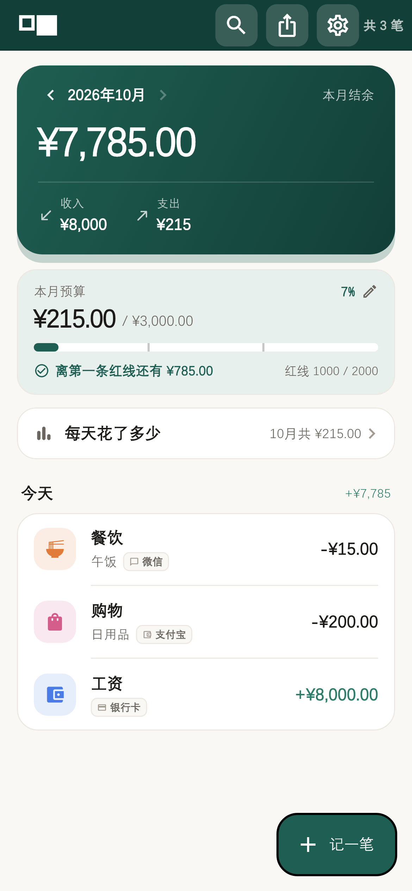
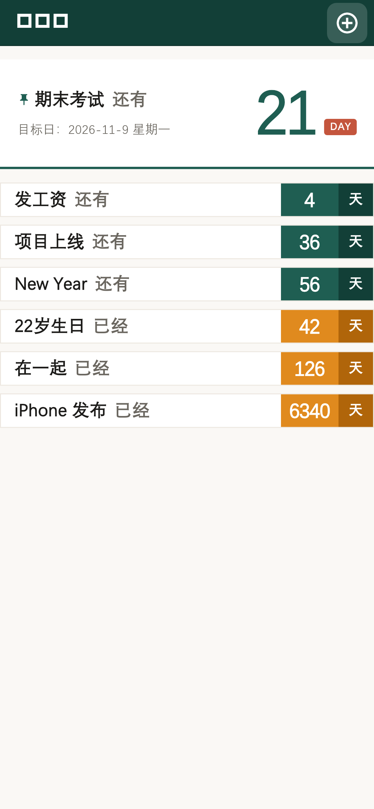
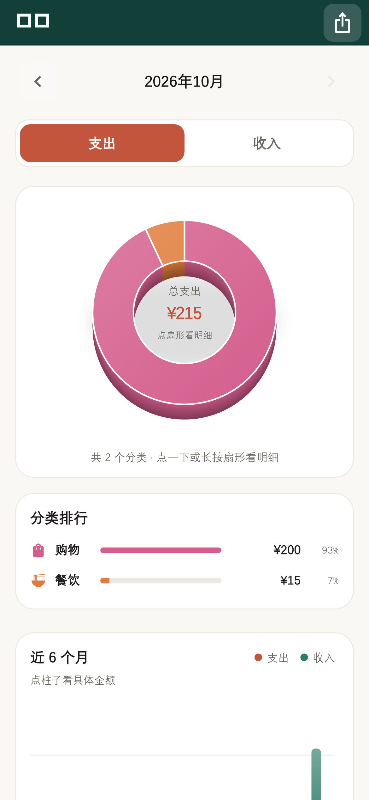
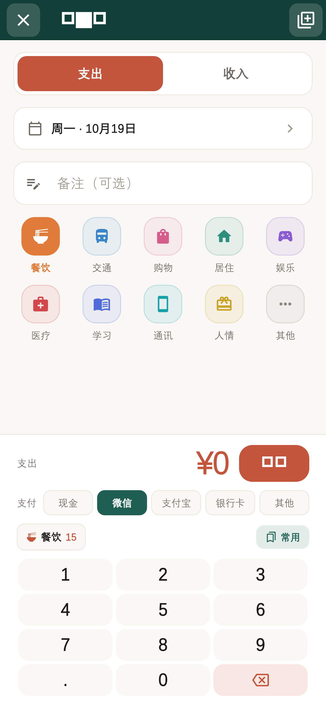
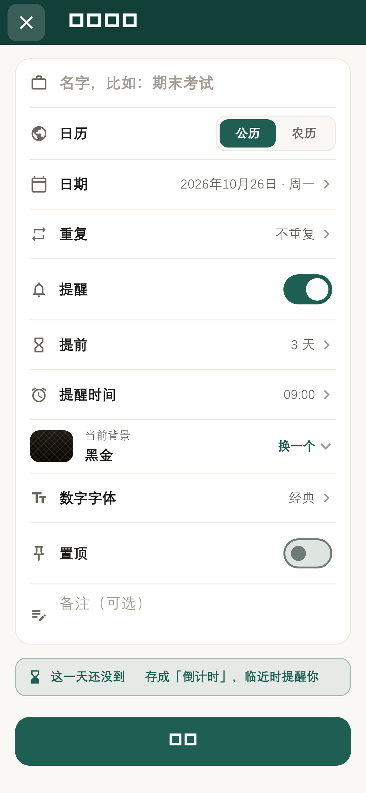
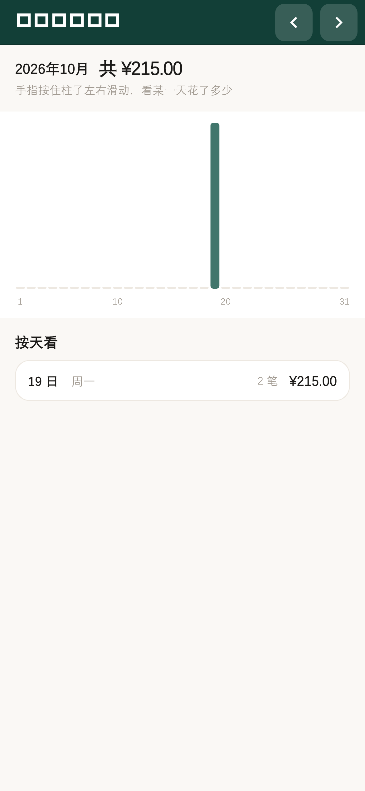
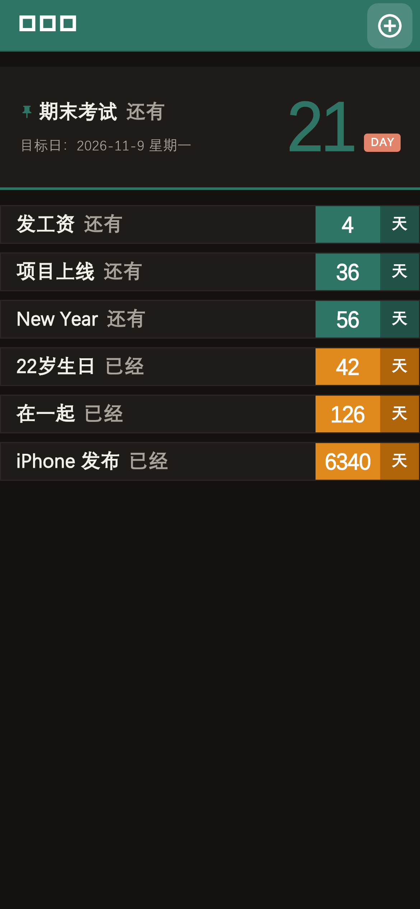

# 日贝 · RiBei

**一个纯本地的安卓记账 App：记账 + 倒计时 + 待办 + 纪念日。**
**不联网、不上传、不需要账号** —— 数据只在你自己的手机里。

  
  
  

## 👉 [**点这里下载最新版**](../../releases/latest)

> 下载那个 `.apk` 附件就行（文件名形如 `RiBei-v1.6.20.apk`）。**不用注册、不用登录、没有广告。**

---

## 怎么装（三步）

1. **下载**：点上面的链接，或在手机浏览器里打开本页面，下载 Release 里的 apk。
2. **安装**：点开下载好的 apk → 系统会问「是否允许安装未知应用」→ 允许 → 安装。
   （这个 App 没上架应用商店，所以会出现这个提示，属于正常现象。）
3. **打开**：第一次打开会有一页说明，建议把「一键开启通知权限」当场点掉。

装完就是下面这样 👇

  
  
  

## ⚠️ 两件一定要知道的事

**① 永远不要「卸载重装」。**
这个 App 的数据只存在你手机本地，**卸载会把账本一起删掉，谁都救不回来**。
升级请一律「直接覆盖安装」（同一签名，数据全部保留）。

想保险就定期到 **设置 → 数据 → 数据与备份** 导出一份 `.db` 备份。

**② 国产手机必须手动放行「提醒」。**
否则倒计时和待办**不会准时响**（会被系统省电策略掐掉）。去这几处开一下：

| 去哪儿 | 开什么 |
|---|---|
| 设置 → 应用 → 日贝 | **省电策略 → 无限制** |
| 设置 → 应用 → 日贝 | **自启动 → 允许** |
| 设置 → 应用 → 日贝 → 其他权限 | **闹钟和提醒 → 允许** |
| 设置 → 应用 → 日贝 → 通知管理 | **锁屏通知 / 悬浮通知 → 允许** |

缺了「闹钟和提醒」这一项，提醒会被系统随意推迟——表现就是"经常不响"。
App 里的 **设置 → 提醒 → 提醒自检** 会告诉你到底是哪一项没开。

---

## 基本操作

### 记账

从「账本」页右下角的 **＋ 记一笔** 进去：

1. 上面选 **支出 / 收入**，再选 **日期**（默认今天，可以补记过去的）
2. 下面用自带的数字键盘输金额，选 **支付方式**（现金/微信/支付宝/银行卡/其他）
3. 点一个分类格子，想加备注就加，**保存**

几个省事的功能：

- **常用**：把一整套记账（类型+分类+金额+备注+支付方式）存下来。下次在键盘上方那一排点一下，**直接就记好了**。像"午饭 15 块"这种天天有的，两秒钟搞定。
- **连记**（右上角那个开关）：打开后**保存不关页**，金额和备注自动清空，接着记下一条。对着小票一路记完再退出来。
- 想改一笔账：在流水里点它就能编辑，长按可以删除。
- 找一笔旧账：右上角**放大镜**，可以搜备注、分类、金额。

### 月度预算（可选，但强烈建议）

在「账本」页的 **本月预算** 卡片上点一下：

- 先设一个**本月预算总额**
- 再加几条**金额红线**（比如 1000、2000、2500）

然后这张卡会**跟着你的花销变色**：

| 状态 | 卡片颜色 |
|---|---|
| 还在预算内 | 淡绿 |
| 跨过第 1 条红线 | 黄 |
| 跨过第 2 条 | 橙 |
| 跨过第 3 条 / 超了预算 | 红 |
| **超预算 20% 以上** | **黑** |

越过红线的时候 App 还会弹一条提示告诉你。

> 💡 **建议多设几条红线**（比如按"注意 / 收紧 / 别花了"分三档）——只设一个总额的话，颜色就只有绿和红两档，看不出"越来越紧"的感觉。

### 倒计时 / 纪念日

从「倒计时」页右上角的 **⊕** 进去，**只需要填名字、选日期**：

- 选**过去**的日子 → 自动变成**纪念日**（"已经 N 天"，正计时）
- 选**今天或以后** → 自动变成**倒计时**（"还有 N 天"，带提醒）
- 选**农历** → 一定是倒计时（每年按农历自动轮转，闰月也处理了）

要点：

- 想开来看看：点列表里的一条，进去是一张**海报**（"还有 / 已经 N 天"），可以**分享成图片**发朋友圈
- 改内容：海报底部有「编辑 / 背景」；**8 套背景主题**（黑金 / 玉青 / 深空蓝 / 暖橙日暮 / 极简白 / 粉雾爱心 / 原木 / 薄荷）
- **置顶**：长按 → 置顶，它会在最上面放大成一张头条卡（同一时刻只置顶一个）
- **批量删除**：长按任意一条就进多选（像微信那样），勾几条然后删

### 待办

右下角 **＋ 添加待办**：内容 + 提醒时间 + 优先级（低/中/高/急）+ 重复（每天/每周/每月）。

- 高优先级的会自动置顶，卡片左边有颜色条
- 勾选就完成，可从点击处爆开一圈动画；重复的会**自动推到下一次**（不会消失）
- 逾期宽限期可设：比如「逾期 15 分钟内还算宽限中」，不会立刻标红

### 统计 & 分享

「统计」页有：分类占比**立体饼图**（点/长按某一个扇区会抬起来看明细）、分类排行、近 6 个月趋势、每天花了多少。

**分享账单**：把一个月（或自己选的日期区间）的账画成一张图，走系统分享面板发给朋友。

### 深色模式 / 触感

设置里可以选 主题（跟随系统 / 浅色 / 深色）、触感反馈（三档强度）。
深色模式长这样 👇

  

---

## 这个 App 特别在哪

### 它真的不联网

- **安装包里没有申请 `INTERNET` 权限** —— 也就是说，在系统层面它**没有能力**联网，包括它用到的第三方库。代码里也没有任何网络请求。
- **不参与系统云备份**（`allowBackup=false`），数据不会被传到任何云端。
- 没有账号、没有埋点、没有广告 SDK。

你的账本就是一个**存在手机里的 SQLite 文件**。你可以在「设置 → 数据 → 数据与备份」里看到它的路径和条数，随时导出。

代价也很实在：**换手机、卸载重装都不会自动恢复**。所以请自己导出备份。

### 提醒是"闹钟级"的

用的是 Android 的 `setAlarmClock` 档位（不受省电模式限流），而不是普通定时器 —— 这是"提醒能不能准点响"的关键差别。

### 一个很小但很爽的细节

倒计时的名称或备注里如果含「**生日**」，到了那天打开 App，会有一个**代码画的蛋糕**（蜡烛火苗会摇曳）+ 飘落彩纸 + 祝福语。一天只弹一次。

---

## 常见问题

**Q：提醒不响 / 总是晚几分钟？**
见上面「两件一定要知道的事」第 ② 条，把那四处系统设置开全。App 里的「设置 → 提醒 → 提醒自检」会告诉你缺哪一项。

**Q：升级之后账本空了？**
**先别慌，更不要卸载重装。** 如果界面上有「数据读取失败」的提示，那是**读不出来**，不是数据没了——数据还在盘上。
先覆盖安装最新版；还不行就去「设置 → 数据 → 数据与备份」看**记录条数**，不为 0 就说明数据还在，导出一份 `.db` 留底。

**Q：安装包怎么 60 多 MB？**
这是**三架构通用包**（arm64-v8a / armeabi-v7a / x86_64），任何手机都能装。按单个架构打会小一半，但那样得发好几个包让用户自己挑。

**Q：能同步到云端 / 多设备吗？**
不能，而且是刻意的。要同步就得有服务器，有了服务器数据就不只在你手机里了。

**Q：会收费吗？**
不会。没有登录、没有内购、没有广告。如果它帮到你了，App 里有赞助入口，完全自愿。

**Q：iOS 版？**
短期不做。除了要 Mac 和 Apple 开发者账号，还有个硬限制：iOS 每个 App 最多只能有 64 条待触发的本地通知，而这个 App 每个倒计时要排「提前天数 + 1」条（最多 61 条），上 iOS 得先重做通知策略。

---

## 想改代码 / 自己编译

请看 [`docs/接手说明.md`](docs/接手说明.md) —— 里面有工程结构、**35 条踩坑红线**、数据库迁移规矩和交付流程。
上手先跑 `flutter test`（135 个单元测试）和 `python tools/check_migration_v4.py`（离线验证数据库迁移）。

> ⚠️ 自己编译出来的包**签名和官方不同**，装到已装官方版的手机上会「签名不一致」装不上，只能卸载重装（会丢数据）。**自己玩可以，别发给已经在用官方版的人。**

更多文档：[`docs/使用说明.md`](docs/使用说明.md)（完整功能说明 + 每个版本的更新记录）、
[`docs/从零看懂日贝.md`](docs/从零看懂日贝.md)（一份很长的教学长文，从零讲清这个 App 每一块是怎么写的）、
[`docs/项目制作过程.md`](docs/项目制作过程.md)（项目管理视角：每个阶段做了什么、踩了什么坑）。

## 许可

[MIT](LICENSE) —— 随便用、随便改、随便分发，保留版权声明即可。

感谢这些开源项目：Flutter、sqflite、provider、flutter_local_notifications、shared_preferences、fl_chart、share_plus、intl、timezone。
